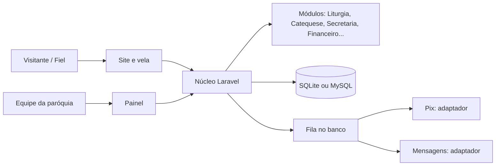

# 2. Arquitetura

## Decisões
- **Monólito modular em Laravel** (PHP 8.3+), Blade + Alpine.js + Tailwind. Estrutura `app/Modules/<Modulo>` com fronteiras claras.
- **Banco:** SQLite por padrão (instalação sem configuração) e MySQL/MariaDB opcional. Mesmo código para os dois.
- **Sem dependências externas em tempo de execução** (CDN, fontes e scripts de terceiros). Tudo local.
- **Módulos ativáveis** no painel: a paróquia liga só o que usa. Cada módulo declara suas permissões, menus, rotas e migrações.
- **Instalação:** `docker compose up` ou `composer install` + `php artisan igreja:instalar` (cria banco, administrador e dados básicos). Arquivos de front-end já compilados no release.
- **Atualização:** `php artisan igreja:atualizar` aplica migrações em ordem, com backup automático antes.
- **Integrações por adaptadores** (Pix, mensagens): interface própria e implementações trocáveis por paróquia, com credenciais criptografadas.
- **Filas:** fila no próprio banco, sem Redis. Tarefas pesadas (relatórios, envios) rodam em segundo plano.
- **API REST** versionada (`/api/v1`) para o calendário e, com autenticação, para os demais módulos (ver [API pública](integracoes/api-publica.md)).
- **Extensões:** módulos de terceiros podem ser instalados como pacotes Composer seguindo um contrato documentado (rotas, permissões, migrações, menu).

## Qualidade e segurança
- Testes automatizados (Pest/PHPUnit), análise estática, CI no GitHub Actions.
- Senhas com hash forte, bloqueio por tentativas, 2FA opcional, CSRF, CSP restritiva, escape de saída, validação de entrada, limite de requisições.
- Trilha de auditoria nas tabelas sensíveis (quem fez o quê e quando).
- Backups simples e documentados (cópia do arquivo SQLite e do `.env`, ou dump do MySQL), com orientação de criptografia.
- Nenhum dado pessoal em log.

## Hospedagem
VPS pequena, hospedagem compartilhada com PHP 8.3, ou contêiner. O Zenoi pode oferecer hospedagem e instalação como serviço pago (ver [modelo de negócio](07-licenca-e-modelo-de-negocio.md)).
